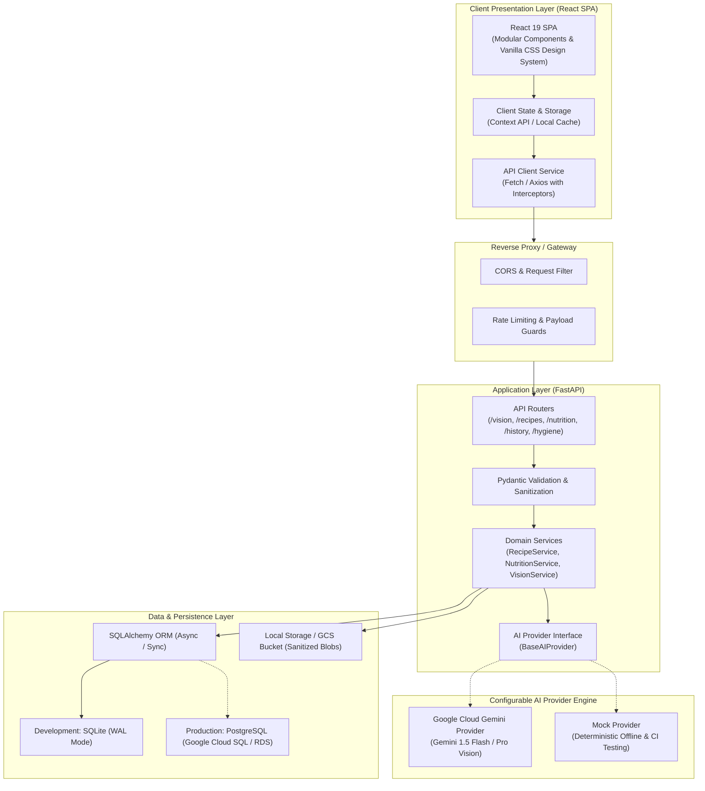
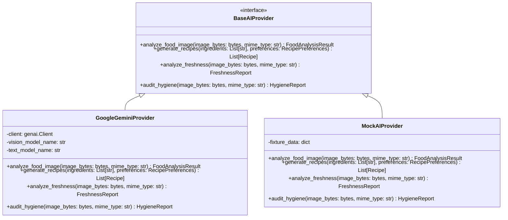
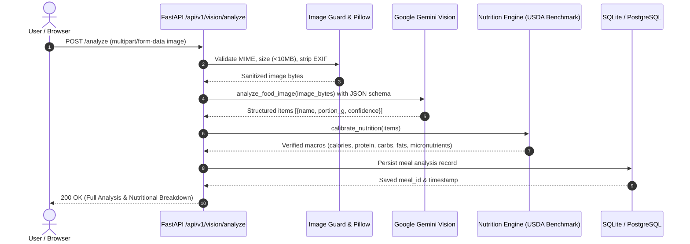
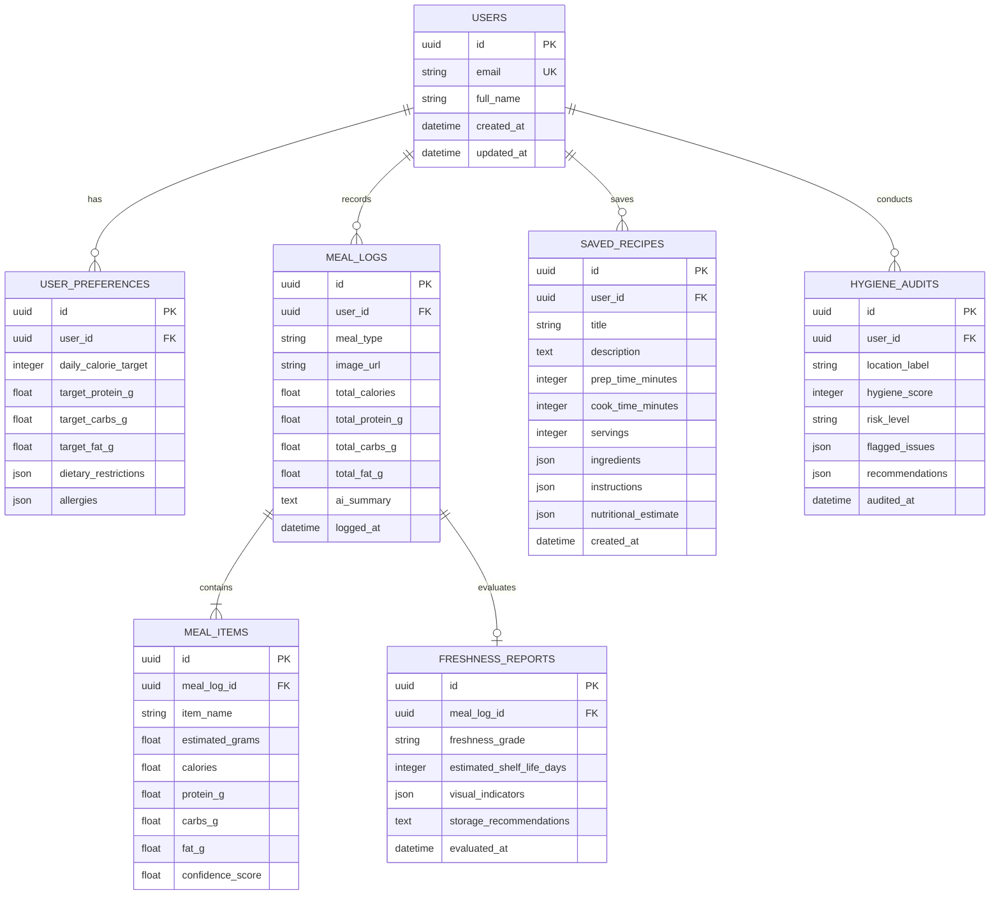

# Food Verse AI — System Architecture & Technical Specification

**Program:** NASSCOM FutureSkills Generative AI with Google Cloud  
**Document Version:** 1.0.0  
**Target Environment:** Local Development / Google Cloud Run (Primary) / AWS Compatible (Fallback)  

---

## 1. System Overview & Architectural Principles

Food Verse AI is architected as a **decoupled, modular client-server web application** adhering to 12-Factor principles. The system isolates volatile AI dependencies behind an abstract provider layer, ensuring the core domain logic (meal logging, recipe processing, nutritional calculation) remains testable, secure, and vendor-agnostic.

### Architectural Principles
1. **Decoupled Client-Server:** Complete separation between the React single-page application (presentation) and the FastAPI service (business logic & AI orchestration).
2. **Provider Agnostic AI Layer:** All interactions with generative vision and language models pass through an abstraction interface, enabling seamless switching between Google Cloud Gemini, local mock providers, or alternative models without refactoring domain code.
3. **Defense-in-Depth Security:** No AI keys or credentials ever reach the client. All incoming payloads (text and binary images) undergo strict structural and safety validation.
4. **Deterministic Grounding:** AI generative output is cross-referenced with deterministic nutritional heuristics and structured Pydantic schemas to mitigate hallucinations.
5. **Portability & Containerization:** Packaged as standard OCI Docker containers to resolve the Google Cloud vs. AWS deployment discrepancy effortlessly.

---

## 2. High-Level System Architecture Diagram

---

## 3. Component Details & Subsystems

### 3.1 Frontend Architecture (React)
- **Framework & Tooling:** React (v18/19), modern JavaScript (ES2023+), bundled with Vite for ultra-fast HMR and optimized production bundles.
- **Styling Architecture:** Pure modern Vanilla CSS using CSS Custom Properties (Design Tokens), responsive Flexbox/Grid layouts, glassmorphic accents, and micro-interactions. Zero external utility frameworks (Tailwind-free per constraints).
- **Component Hierarchy:**
  - `components/common/`: Buttons, Cards, Modals, Loading Skeletons, Alert Banners, File Dropper.
  - `components/dashboard/`: Daily macro summary gauge, recent meal cards, quick-action tiles.
  - `components/vision/`: Image capture/upload widget, preview canvas, bounding/item tags, confidence badges.
  - `components/cooking/`: Pantry ingredient tagger, dietary filter toggles, recipe step viewer.
  - `components/nutrition/`: Macro distribution charts, target comparison bars, nutrient breakdown tables.
  - `components/optional/`: Freshness timeline inspector, hygiene risk scorecard.
- **Error & State Handling:** Centralized API service with global error boundaries, toast notifications, and optimistic UI updates.

### 3.2 Backend Architecture (Python & FastAPI)
- **Framework:** FastAPI with Python 3.11+, providing native asynchronous request handling, OpenAPI auto-documentation, and dependency injection.
- **Layered Structure:**
  - `routers/`: Thin controllers defining HTTP verbs, route paths, and HTTP status codes.
  - `schemas/`: Pydantic models for request validation, response serialization, and OpenAPI contract specification.
  - `services/`: Business logic orchestrating AI inference, nutritional calculations, and database operations.
  - `ai_providers/`: Pluggable AI model clients implementing `BaseAIProvider`.
  - `models/`: SQLAlchemy database models.
  - `database/`: Engine setup, session factories, and migration scripts.
  - `core/`: Application settings (`pydantic-settings`), security utilities, and logging configurations.

---

## 4. AI Provider Abstraction Layer

To ensure robustness, testability, and adherence to Google Cloud while allowing future flexibility, all AI operations are mediated by an abstract base class:

### Prompt Engineering & Structured Outputs
- **Structured JSON Output:** All AI prompts enforce JSON response schemas conforming directly to Pydantic definitions using model system instructions and schema definitions.
- **Anti-Hallucination Guardrails:** AI prompts explicitly prohibit inventing non-standard nutrients and instruct the model to mark unknown ingredients with low confidence.
- **Image Sanitization:** Uploaded images are re-encoded via Pillow to verify image headers, strip malicious EXIF metadata, and downscale images larger than 2048x2048 to minimize token usage and latency.

---

## 5. Nutrition Intelligence Engine (Hybrid Approach)

To ensure reliable, medically grounded nutritional metrics:
1. **Visual Ingredient Extraction:** The vision AI identifies items (e.g., "grilled salmon", "steamed broccoli", "brown rice") and estimates portion sizes in grams/cups.
2. **Deterministic Lookup & Calibration:** The backend queries a curated nutritional reference table (modeled on standard USDA FoodData Central values for common base ingredients).
3. **Generative Contextualization:** Where exact matches are ambiguous (e.g., complex composite sauces), the AI provides bounded estimations clearly flagged with an estimation confidence index.

---

## 6. Database Architecture & Entity-Relationship Diagram

---

## 7. Security, Privacy & Compliance Architecture

1. **API Key Isolation:**
   - Client applications never access the Google Gemini API or Cloud credentials directly.
   - All AI calls originate from the FastAPI backend using environment-configured variables (`GOOGLE_API_KEY` or GCP Application Default Credentials).
2. **Input Validation & Sanitization:**
   - Strict content type enforcement (`image/jpeg`, `image/png`, `image/webp`).
   - Binary verification: Header signature inspection via `python-magic` or Pillow.
   - File size ceiling: Enforced at 10 MB maximum.
   - Pydantic models validate all JSON payloads against strict boundaries (e.g., calorie targets must be positive integers between 500 and 10,000).
3. **CORS Policy:**
   - Configurable allowed origins; strictly rejects wildcard `*` when credentials are permitted.
4. **Data Privacy & Retention:**
   - Uploaded food images are processed in-memory or stored as temporary sanitized files.
   - No personally identifiable health data is transmitted to model prompts.
   - User endpoints support meal history deletion to respect data erasure rights.

---

## 8. Deployment Architecture (Resolving Google Cloud vs. AWS)

### 8.1 Primary Deployment: Google Cloud Platform (Recommended for Program)
- **Container Registry:** Google Cloud Artifact Registry (`gcr.io` or `pkg.dev`).
- **Compute:** Google Cloud Run (Fully managed serverless container service).
  - Autoscaling to zero when idle, minimizing cost.
  - Automatic HTTPS termination and custom domain support.
- **Database:** Google Cloud SQL (PostgreSQL) or managed Cloud Storage for SQLite backups during low-traffic demo tier.
- **Secrets:** Google Secret Manager mounted into Cloud Run container environment.

### 8.2 Fallback/Secondary Deployment: AWS Compatibility
- Because both frontend and backend are encapsulated in standard Dockerfiles:
  - Backend runs seamlessly on **AWS App Runner** or **Amazon ECS (Fargate)**.
  - Image storage seamlessly maps to **Amazon S3** via S3 API wrappers.
  - Database connects to **Amazon RDS (PostgreSQL)** without code modifications.
- Infrastructure scripts for both clouds will be provided in `deploy/` templates.
