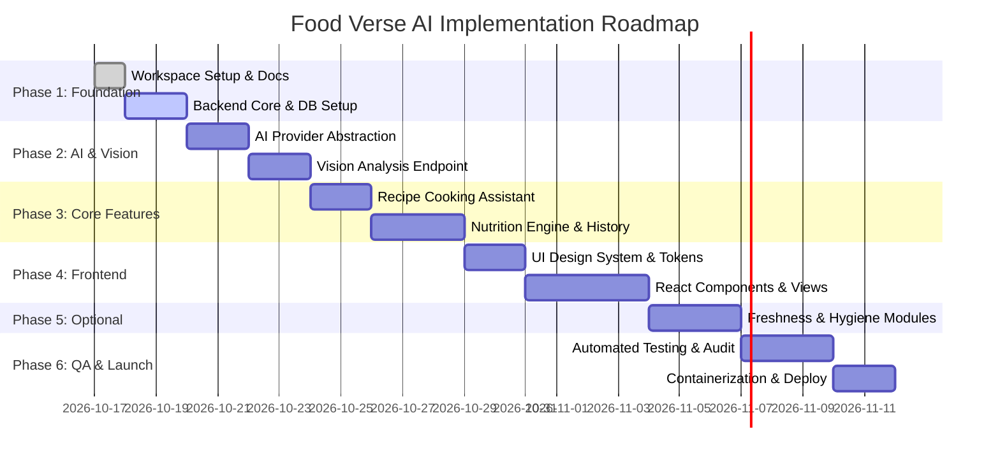

# Food Verse AI — Project Plan

**Program:** NASSCOM FutureSkills Generative AI with Google Cloud Program  
**Project Type:** Internship Capstone Project  
**Version:** 1.0.0  
**Status:** Approved for Implementation Planning  
**Last Updated:** October 2026  

---

## 1. Executive Summary & Objectives

**Food Verse AI** is an intelligent, multi-modal culinary and nutritional intelligence platform designed to bridge visual food perception with personalized health recommendations and kitchen resource management. The application leverages Google Cloud-compatible generative AI models (Gemini multi-modal vision and text models) alongside deterministic nutrition benchmarks to deliver accurate ingredient analysis, dynamic recipe creation, dietary planning, and visual safety/freshness insights.

### Primary Objectives
1. **Multi-Modal Vision Recognition:** Identify prepared dishes, raw ingredients, and food items from user-uploaded images or camera snapshots with structured ingredient decomposition.
2. **Dynamic Culinary Assistant:** Generate viable, tailored recipes based on currently available pantry ingredients, dietary restrictions, and cooking time constraints.
3. **Personalized Nutrition Engine:** Synthesize verified nutritional reference standards with generative insights to deliver realistic macro/micronutrient tracking and meal plans.
4. **Kitchen Safety & Hygiene Insights (Optional):** Provide early visual indicators of ingredient spoilage/freshness and restaurant/kitchen cleanliness cues.
5. **Production-Ready Engineering:** Deliver a decoupled, modular full-stack web application adhering to security best practices, automated testing, and cloud-ready containerization.

---

## 2. Project Scope & Boundary Definition

To guarantee timely delivery and maintain strict quality standards, features are organized into **Core (Must-Have)** and **Optional (Enhancement)** categories.

### 2.1 Core Features (P0 / P1)
- **Multi-Modal Food & Ingredient Recognition:** Image upload/capture, vision analysis via AI model, confidence scoring, ingredient itemization, and portion estimates.
- **Smart Cooking Assistant:** Recipe synthesis from pantry inventory, substitution suggestions, time/equipment filtering, and step-by-step instructions.
- **Nutritional Planner & Tracker:** Daily macro/micronutrient budgeting (calories, protein, carbs, fats), dietary goal alignment (keto, vegan, diabetic-friendly, high-protein), and nutritional breakdowns grounded in standard reference benchmarks.
- **User Dashboard & History:** Visual dashboard summarizing daily consumption, historical meal logs, favorite recipes, and interactive analytics.
- **Responsive Web Interface & Resilient Error Handling:** Modern, responsive UI with clean status indicators, graceful fallbacks, and validation notifications.

### 2.2 Optional Features (P2 - Post-Core Evaluation)
- **Visual Freshness & Spoilage Assessment:** Qualitative assessment of produce/dairy/meat freshness, shelf-life estimations, and storage advice.
- **Restaurant & Food Prep Hygiene Screener:** Visual cleanliness evaluation of preparation environments, surface condition analysis, and risk cue flagging.

---

## 3. Unresolved Deployment Decision: Google Cloud vs. AWS CLI

### 3.1 Context & Discrepancy Analysis
A foundational contradiction exists in the project documentation:
- **Program Alignment:** The project is completed under the *NASSCOM FutureSkills Generative AI with Google Cloud* program, which prescribes Google Cloud Platform (GCP) technologies (Vertex AI / Gemini API, Google Cloud Run, Cloud Storage, Secret Manager).
- **Legacy/Template Reference:** Certain upstream project descriptions or assignment briefs reference the *AWS CLI* and AWS deployment targets (e.g., S3, ECS, or Lambda).

### 3.2 Impact Assessment
- Developing specifically for AWS would violate the program's primary charter (Generative AI with Google Cloud) and compromise grading rubrics tied to Google Cloud services.
- Hardcoding either cloud platform into application logic creates vendor lock-in and hinders local testing.

### 3.3 Resolution Strategy & Architectural Mitigation
1. **Cloud-Agnostic 12-Factor Architecture:** The application core is decoupled from specific cloud infrastructure using containerization (Docker) and environment-driven configurations (`.env`).
2. **Provider Abstraction Layer:** AI services interact via an abstract interface (`AIProviderInterface`), with a first-class **Google Cloud Gemini / Vertex AI** implementation, plus a local/mock provider for offline testing and CI.
3. **Primary Deployment Target (Google Cloud):**
   - **Compute:** Google Cloud Run (serverless container execution).
   - **AI Services:** Google GenAI SDK / Vertex AI Gemini 1.5 Flash & Pro.
   - **Storage:** Google Cloud Storage (or signed URLs) for persistent image blobs; SQLite/Cloud SQL (PostgreSQL) for relational state.
   - **Secrets:** Google Secret Manager or secure environment variables.
4. **Secondary/Fallback Target (AWS CLI Ready):**
   - Because the core services are packaged as standard OCI-compliant Docker containers, deployment via AWS CLI to AWS App Runner / Amazon ECS and S3 remains 100% viable with zero code rewrites, simply changing infrastructure provisioning scripts.
5. **Action Item:** Log this discrepancy as an open clarification request to program evaluators while proceeding with the cloud-agnostic containerized approach with Google Cloud as default.

---

## 4. Implementation Phases & Milestones

### Milestone Summary
- **Milestone 1 (Foundation):** Workspace configured, Git initialized, documentation approved, FastAPI scaffolded, database schema defined with SQLite/SQLAlchemy.
- **Milestone 2 (AI Abstraction & Vision):** Provider interface completed, Google Gemini integration operational, prompt templates structured with JSON schemas, unit tests with mock provider passing.
- **Milestone 3 (Core Services):** Recipe generation engine, USDA-aligned nutrition calculator, and meal history CRUD APIs tested and verified.
- **Milestone 4 (Frontend UI/UX):** Responsive React application with dashboard, camera/file upload, interactive recipe builder, and nutrition analytics.
- **Milestone 5 (Optional Capabilities):** Produce freshness classifier and kitchen hygiene audit pipelines integrated behind feature flags.
- **Milestone 6 (Verification & Handover):** End-to-end integration tests, security checklist signed off, Docker container built, deployment guide finalized.

---

## 5. Risk Management & Mitigation Matrix

| Risk ID | Risk Description | Severity | Probability | Mitigation Strategy |
| :--- | :--- | :---: | :---: | :--- |
| **RSK-01** | AI Hallucinations in nutritional or allergen data | High | Medium | Ground model output with verified baseline nutritional tables; display clear health disclaimers; enforce strict JSON response schema. |
| **RSK-02** | Exposure of Google Cloud API keys | Critical | Low | Keep all AI calls behind FastAPI backend; use `.env` files ignored by Git; enforce secret management; client never receives keys. |
| **RSK-03** | Cloud provider mismatch (GCP vs AWS) | Medium | Medium | Dockerize both frontend and backend; use 12-factor configuration; ensure deployment scripts exist for both GCP and AWS. |
| **RSK-04** | API rate limits and unexpected latency | Medium | High | Implement local caching for repeated ingredient lookups; configure async streaming responses; provide client loading skeletons. |
| **RSK-05** | Malicious file uploads (malware, bombs) | High | Low | Validate magic bytes (MIME type); limit image sizes to 10MB; process and sanitize images using Pillow before downstream processing. |
| **RSK-06** | User data privacy concerns | Medium | Low | Do not persist biometric data; provide option to delete meal history; do not use uploaded images for public model training. |

---

## 6. Version Control & Engineering Conventions

### Git Branching Model
- `main`: Production-ready, verified code only. Protected branch.
- `develop`: Primary integration branch for completed feature tasks.
- `feature/<name>`: Feature branches created off `develop` (e.g., `feature/vision-recognition`, `feature/recipe-assistant`).
- `fix/<name>`: Bug fix branches addressing specific test failures.

### Commit Guidelines
Conventional Commits format:
- `feat(scope): add vision analysis pipeline`
- `fix(backend): correct CORS header origins`
- `test(nutrition): add macro calculation unit tests`
- `docs(arch): update database ER diagram`

---

## 7. Deliverables & Documentation Index
1. `docs/PROJECT_PLAN.md` (This document)
2. `docs/ARCHITECTURE.md` (System design, schemas, API contracts, sequence flows)
3. `docs/FEATURES.md` (Functional requirements, acceptance criteria, prompt specs)
4. `docs/DEVELOPMENT_CHECKLIST.md` (Exhaustive task tracking, verification criteria)
